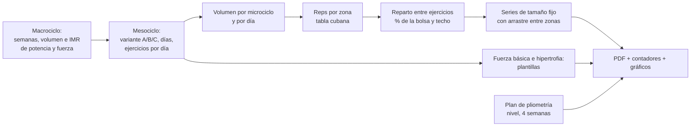

# Generador de rutinas

Programa de escritorio para programar mesociclos de sobrecarga con el **método cubano de distribución de repeticiones** (H. Anselmi, *Actualizaciones sobre el entrenamiento de la potencia*, cap. 8). Reemplaza la planilla `Rutina.xlsx`: a partir del volumen y la intensidad que planificás para cada mesociclo, calcula solo las series × repeticiones × kg de cada ejercicio, con series parejas (escalera de peso) y contadores que muestran cuánto se aparta de la teoría. Exporta un PDF con el formato de la planilla del entrenador para llevar al gimnasio.

## Qué tiene

- **Ejercicios:** potencia, fuerza, hipertrofia y pliometría. Cada ejercicio tiene una ficha con su 1RM, el objetivo, el techo de intensidad, las repeticiones por serie propias de cada zona y un gráfico de cómo evoluciona su 1RM.
- **Plantillas:** las tablas del método (microciclos, días, distribución por intensidad, repeticiones por serie, plantillas de fuerza básica e hipertrofia, volúmenes de pliometría). Son editables, con un botón para restaurar los valores originales.
- **Macrociclo:** calendario del año con los mesociclos y los planes de pliometría, más el gráfico anual de volumen e intensidad.
- **Mesociclo:** la grilla de días y ejercicios, con las series que se calculan solas, los contadores, el gráfico planificado vs real y el botón **Exportar PDF**.
- **Perfiles:** cada persona tiene sus propios ejercicios, 1RM y mesociclos. Las plantillas son compartidas.

## Requisitos

- Java 21
- Maven 3.9 (solo para compilar)

## Compilar, ejecutar y testear

```bash
mvn package
```

```bash
java -jar target/rutina-1.0.0-jar-with-dependencies.jar
```

```bash
mvn test
```

## Dónde guarda los datos

En `~/.local/share/rutina/rutina.db` (o `$XDG_DATA_HOME/rutina/rutina.db` si esa variable está definida). Es un único archivo SQLite: para hacer una copia de seguridad alcanza con copiarlo. Si el archivo se daña, el programa lo renombra a `rutina.db.bak-<fecha>` y empieza uno nuevo; nunca lo pisa.

Los PDF se guardan donde elijas al exportar (por defecto, en `~/Documentos`).

## Cómo calcula



El detalle de cada regla está en [`docs/2026-10-21-generador-rutinas-design.md`](docs/2026-10-21-generador-rutinas-design.md).

## Estructura

- `com.rutina.model`: datos (ejercicio, mesociclo, metodología…).
- `com.rutina.service.calculo`: el motor de cálculo, sin interfaz ni base de datos, con tests.
- `com.rutina.service.datos`: SQLite y los datos iniciales de las planillas.
- `com.rutina.pdf`: el exportador.
- `com.rutina.ui`: la interfaz Swing.
