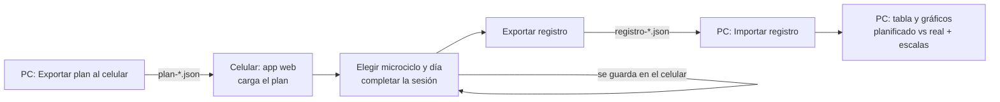

# Registro de sesiones — Especificación

*2026-10-24 · Contrato común de todas las tareas `tareas/T*.md`. Si una tarea y este documento no coinciden, manda este documento.*

## 1. Para qué es

El programa de la PC (Java, Swing) planifica el mesociclo y exporta un PDF. Falta saber **qué se hizo de verdad** en cada sesión. El usuario quiere anotarlo **en el celular, en el gimnasio, sin internet**, y después pasarlo a la PC para comparar lo planificado con lo real.

Flujo:



## 2. Escalas (texto exacto)

**Descanso previo** (6 niveles, se muestran de 6 a 1):

| valor | texto |
|---|---|
| 6 | Bien descansado y con ganas de entrenar |
| 5 | Bien descansado |
| 4 | Bien descansado pero distraído |
| 3 | Mal descansado pero con ganas de entrenar |
| 2 | Mal descansado |
| 1 | Mal descansado y sin ganas de entrenar |

**Sensación del ejercicio** (una por ejercicio): 1 Muy liviano · 2 Liviano · 3 Justo · 4 Al límite · 5 Pesado

**Sensación al terminar**: 1 Destruido · 2 Cansado · 3 Normal · 4 Bien · 5 Con energía

Cualquier escala puede quedar **sin completar** (en JSON: `null`).

## 3. Notación de lo realizado

Cada fila de intensidad de un ejercicio tiene una casilla de texto:

- **Vacía** → se hizo exactamente lo planificado.
- **Con texto** → reemplaza lo planificado. Gramática:

```
registro := "0" | serie ( "." serie )*
serie    := reps [ "-" kg ]
reps     := entero 1..99
kg       := dígitos [ "," dígitos ]     (mayor que 0; decimales con COMA: 82,5)
```

- Cada `serie` es una serie. Si tiene `-kg`, esa serie se hizo con ese peso; si no, con el **peso planificado de la serie en la misma posición** de esa fila. Si hay más series que las planificadas, las que sobran usan el peso de la **última** serie planificada.
- `0` = esa fila no se hizo. Solo vale sola: `0.3`, `3.0` y `00` son inválidos.
- Se ignoran los espacios. El punto `.` solo separa series; por eso los decimales del peso van con coma.
- Ejemplos con lo planificado `3.3.3` a 120 kg:
  - `3.3-85.3-80` → 3 reps a 120, 3 a 85, 3 a 80.
  - `3.3` → 3 a 120, 3 a 120.
  - `2.3` → 2 a 120, 3 a 120.
  - `3.3.3.3` → cuatro series a 120.
  - `3-82,5` → 3 reps a 82,5.
- Inválidos: `""` (vacío, no se parsea), `3..3`, `3-`, `-80`, `0.3`, `100`, `3-0`, `a`.
- Ojo: `3-80.5` **no** es un error: se lee como dos series, 3 reps a 80 kg y 5 reps al peso planificado. Por eso los decimales del peso van con coma (`3-80,5`); la app del celular avisa cuando una casilla tiene más series que las planificadas.
- Si una serie no tiene peso y la fila no tiene series planificadas → inválido ("indicá el peso").

## 4. Filas de cada ejercicio (las arma la PC)

- **Aproximación compleja** (potencia y fuerza compleja): una fila por grupo de zonas **que tenga series planificadas** en esa sesión, en este orden y con estas etiquetas:

| etiqueta | zonas | pctMin | pctMax |
|---|---|---|---|
| `55` | Z55 | 55 | 55 |
| `60` | Z60 | 60 | 60 |
| `65` | Z65 | 65 | 65 |
| `70` | Z70 | 70 | 70 |
| `75` | Z75 | 75 | 75 |
| `80-85` | Z80, Z85 | 80 | 85 |
| `90-95` | Z90, Z95 | 90 | 95 |
| `100` | Z100 | 100 | 100 |

  Las series planificadas de la fila son las de sus zonas concatenadas en orden (primero las del 80 %, después las del 85 %). Cada serie lleva su kg = `Redondeo.kg(rm, pctDeSuZona, metodologia.incrementoKg())`.
- **Fuerza básica e hipertrofia**: una sola fila con etiqueta = `CeldaPlantilla.texto()` (por ejemplo `4x12` o `3x5-75/80%`), `pctMin`/`pctMax` de la celda (o `null`), y `series` = `series()` veces `reps()`. Su kg = `Redondeo.kg(rm, (pctMin + pctMax) / 2.0, incremento)` si hay rm y porcentaje; si no, 0.
- **rm** del ejercicio = `mes.rmUsados().getOrDefault(id, ejercicio.rm())`. Si es `null`, todos los kg planificados son 0.

## 5. Archivo del plan (PC → celular)

Nombre sugerido `plan-<perfil>-<inicio>.json`, UTF-8. Ejemplo completo en `ejemplos/plan-ejemplo.json`.

```json
{
  "formato": "rutineitor-plan",
  "version": 1,
  "perfil": "Franco",
  "mesocicloId": 3,
  "inicio": "2026-10-26",
  "microciclos": 5,
  "dias": 3,
  "sesiones": [
    {
      "microciclo": 1,
      "dia": 1,
      "ejercicios": [
        {
          "bloque": "1-2",
          "nombre": "Sentadilla",
          "tipo": "FUERZA",
          "modo": "COMPLEJA",
          "rm": 150.0,
          "filas": [
            { "etiqueta": "80-85", "pctMin": 80, "pctMax": 85,
              "series": [ { "reps": 3, "kg": 120.0 }, { "reps": 3, "kg": 127.5 } ] }
          ]
        }
      ]
    }
  ]
}
```

- `bloque` = `"<dia>-<posicion>"` del `Bloque`; identifica el ejercicio dentro de la sesión.
- `tipo`: `POTENCIA` | `FUERZA` | `HIPERTROFIA`. `modo`: `COMPLEJA` | `BASICA` (hipertrofia siempre `BASICA`).
- `rm`: número o `null`.
- Hay una sesión por cada (microciclo, día), en orden de microciclo y después de día, aunque no tenga ejercicios. Dentro de cada sesión, los ejercicios van ordenados por posición.

## 6. Archivo del registro (celular → PC)

Nombre sugerido `registro-<perfil>-<inicio>.json`. Ejemplo en `ejemplos/registro-ejemplo.json`.

```json
{
  "formato": "rutineitor-registro",
  "version": 1,
  "perfil": "Franco",
  "mesocicloId": 3,
  "sesiones": [
    {
      "microciclo": 1,
      "dia": 1,
      "fecha": "2026-10-27",
      "descanso": 5,
      "final": 4,
      "ejercicios": [
        { "bloque": "1-2", "esfuerzo": 3, "filas": { "80-85": "3.3-125" } }
      ]
    }
  ]
}
```

- Solo aparecen las sesiones **anotadas** (que tienen `fecha`). Una sesión que no está en el archivo no se hizo o no se anotó.
- `descanso`, `final` y `esfuerzo` pueden ser `null`.
- En `filas` solo aparecen las casillas con texto; una etiqueta que no está = como lo planificado.
- Un ejercicio que no aparece en `ejercicios` = hecho como lo planificado, sin esfuerzo anotado.

## 7. Qué calcula la PC con el registro

Nombres que ve el usuario: **Planilla** = lo que dice el PDF (las series planificadas de este plan); **Entrenado** = lo que hizo (el registro). En el código los campos se llaman `…Plan` y `…Real`.

Para cada sesión anotada y cada `tipo` presente en ella:

- **Volumen planificado** = Σ reps de las series planificadas de esos ejercicios.
- **Volumen real** = Σ reps de las series realizadas (de la notación; o las planificadas si la casilla está vacía).
- **IMR** (planificado y real) = promedio de la intensidad de cada serie, ponderado por sus reps. La intensidad de una serie es `kg / rm × 100` si el ejercicio tiene rm y la serie tiene kg > 0. Si no, es `(pctMin + pctMax) / 2` de su fila; si la fila no tiene porcentaje, la serie no cuenta para el IMR. Si ninguna serie cuenta, el IMR es `null`.
- Además se muestran por sesión: fecha, descanso, final y el promedio del esfuerzo de sus ejercicios.

## 8. App del celular

- Carpeta `celular/` en la raíz del repo, sin librerías ni herramientas de compilación:
  - `logica.js`: funciones puras (notación, registro, nombres), sin tocar la pantalla; se prueban con `docs/registro-sesiones/evaluacion/web/pruebas.html`;
  - `index.html`: la pantalla (HTML + CSS + JavaScript) que usa `logica.js`;
  - `manifest.webmanifest`, `sw.js` e `icono.png`: para que funcione sin conexión y se pueda instalar en la pantalla de inicio.
- Se publica **solo la carpeta `celular/`**, no el resto del repo (que tiene tus planillas y datos).
- Se publica con GitHub Pages en `https://perryelortitorico.github.io/rutineitor/`.
- Guarda todo en `localStorage` del celular. No envía datos a ningún lado.
- Pantallas: **Inicio** (cargar plan, elegir plan, exportar registro, borrar) y **Sesión** (elegir microciclo y día, completar).

## 9. No-objetivos

- No sincroniza solo: el usuario pasa los archivos a mano.
- No modifica el plan desde el celular.
- No hay cuentas ni servidor.
